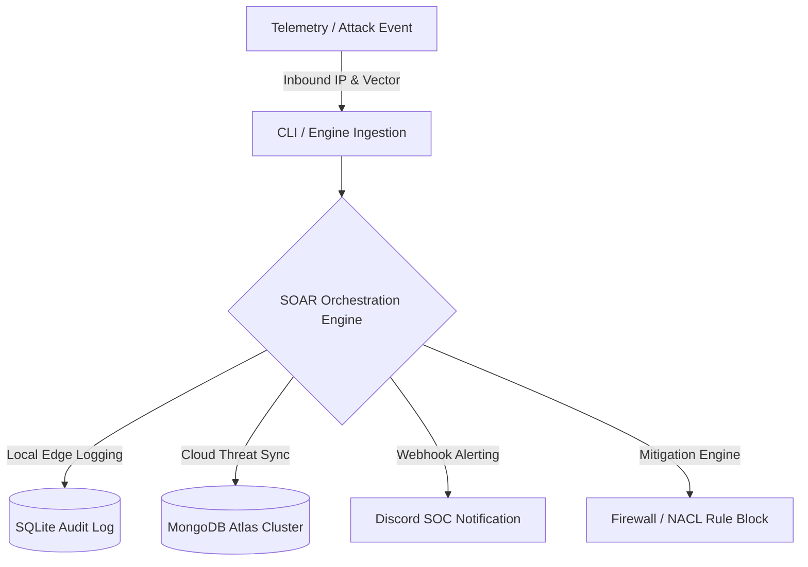
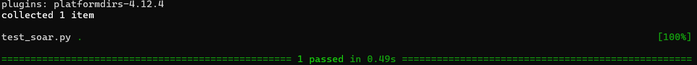
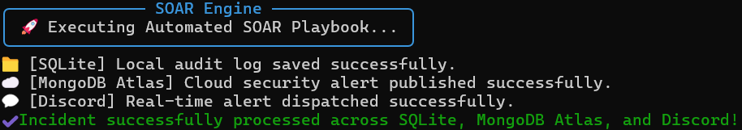
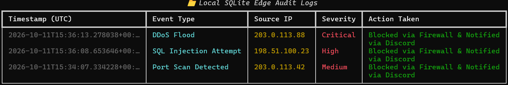
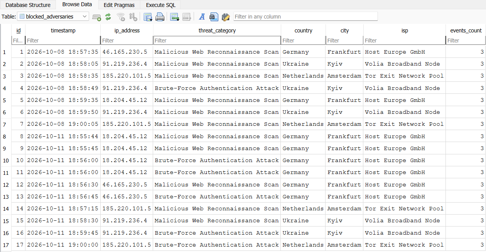
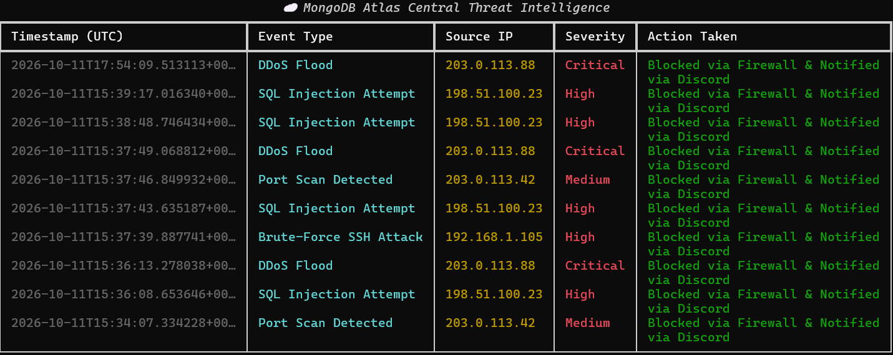
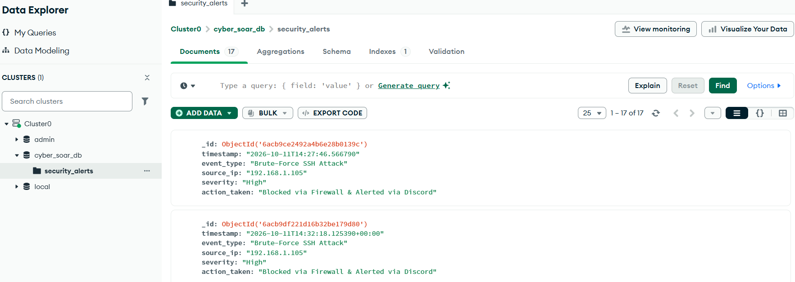
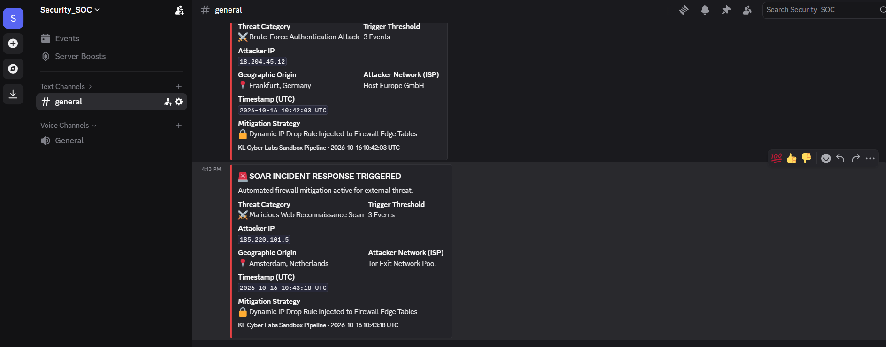

# 🛡️ Cloud-Native SOAR: Automated Threat Detection & Incident Response Pipeline

[](https://www.python.org/)
[](https://www.mongodb.com/)
[](https://discord.com/)
[](LICENSE)
[](#)

A production-grade **Security Orchestration, Automation, and Response (SOAR)** framework designed to ingest threat telemetry, execute automated mitigation playbooks, maintain hybrid audit logging (edge and cloud), and dispatch real-time incident notifications to Security Operations Center (SOC) teams.


## 🏗️ Technical Architecture & Workflow

The pipeline utilizes a hybrid storage architecture: local edge logging to **SQLite3** ensures low-latency fault tolerance during network partitioning, while cloud synchronization to **MongoDB Atlas** maintains a centralized threat intelligence database.


## 🔑 Core Technical Features

| Feature | Technical Implementation | Value & Capabilities |
| :--- | :--- | :--- |
| **Event-Driven Ingestion** | Custom CLI & Engine | Ingests threat telemetry and parses inbound IP/attack vectors in real time. |
| **Hybrid Storage Telemetry** | `SQLite3` & `MongoDB Atlas` | Maintains low-latency local edge logging (`SQLite3`) while syncing centralized threat intelligence (`MongoDB Atlas`). |
| **SOC Webhook Alerting** | `Discord Webhooks` | Dispatches real-time, high-priority incident alerts directly to Security Operations Center (SOC) communication channels. |
| **Automated Mitigation Engine** | `Firewall / NACL` | Programmatically enforces threat containment via automated firewall and network access control list rule blocks. |
| **Terminal UI Dashboard** | `click` & `rich` | Renders interactive CLI execution steps, logs, and live pipeline status updates. |
| **Automated Test Suite** | `pytest` | Validates alert parsing rules, integration paths, and database persistence workflows. |

 ## 📁 Project Directory Layout
 ```text
├── assets/
│   ├── soar_discord_alert_output.png
│   ├── soar_execution_output.png
│   ├── soar_mongo_cli_output.png
│   ├── soar_mongodb_atlas_ui.png
│   ├── soar_pytest_output.png
│   ├── soar_sqlite_gui_output.png
│   └── soar_sqlite_output.png
├── engine/
│   ├── cli.py
│   ├── soar_logger.py
│   └── watchdog.py
├── playbooks/
│   └── attacker_sim.py
├── tests/
│   ├── auth.log
│   ├── test_mongo.py
│   └── test_soar.py
├── .env.example
├── .gitignore
├── LICENSE
├── README.md
└── requirements.txt

```
## 🚀 Live Operational Execution & Verification

Below is the sequential end-to-end operational proof demonstrating the `cyber-soar-pipeline` intercepting security threats, executing automated playbooks, persisting audit trails locally, and synchronizing data to the cloud in real-time.

## Step 1: Automated Unit Testing (Pytest)
The system validates component resilience and data structures via automated `pytest` execution.



## Step 2: Automated SOAR Playbook Execution
When a security incident is triggered from the CLI, the pipeline initializes, logs locally to SQLite, publishes threat intelligence to MongoDB Atlas, and dispatches an instant webhook alert[cite: 7, 10].




## Step 3: Local Edge Persistence — CLI Audit Log
Edge auditing records individual and multi-vector security events locally for immediate forensic inspection.




## Step 4: Local Edge Persistence — DB Browser (GUI)
Below is the tabular inspection of local audit logs using **DB Browser for SQLite**:




## Step 5: Centralized Cloud Threat Intelligence MongoDB Atlas (CLI View)
The CLI queries the cloud cluster to render a consolidated view of global threat intelligence via Rich tables.




## Step 6: Cloud Dashboard Persistence MongoDB Atlas (Cloud UI)
Live document storage verified directly within the MongoDB Atlas cloud cluster dashboard, displaying structured JSON audit documents.




## Step 7. Automated Real-Time Alerting (Discord Webhook)
Demonstrates automated, real-time incident dispatches triggered via Discord webhooks upon threat detection. The pipeline formats dynamic JSON payloads with rich contextual telemetry—including attacker IP, geographical origin, ISP details, and automated firewall mitigation strategies—enabling immediate visibility for SOC analysts.



## 📜 License
This project is licensed under the **MIT License** — see the [LICENSE](LICENSE) file for details.


