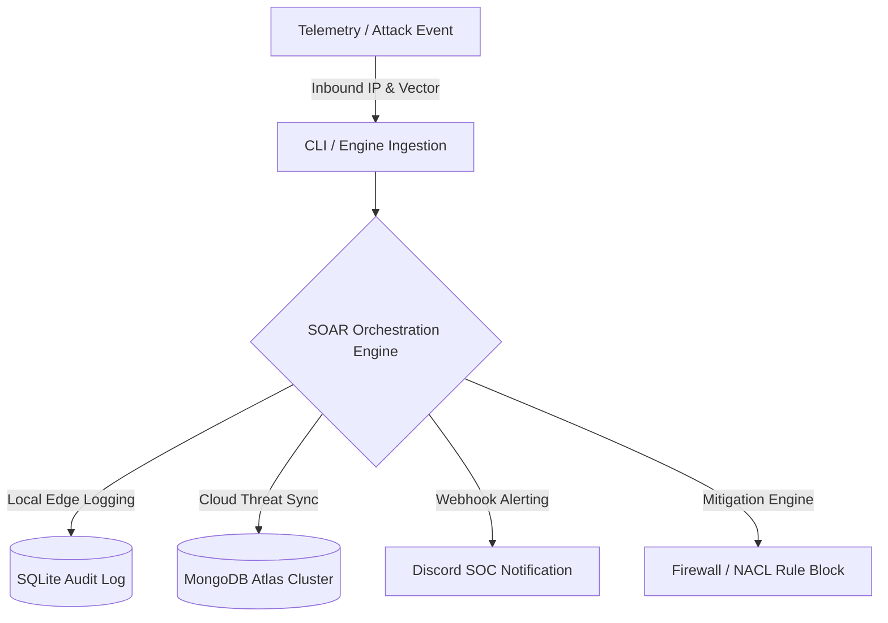
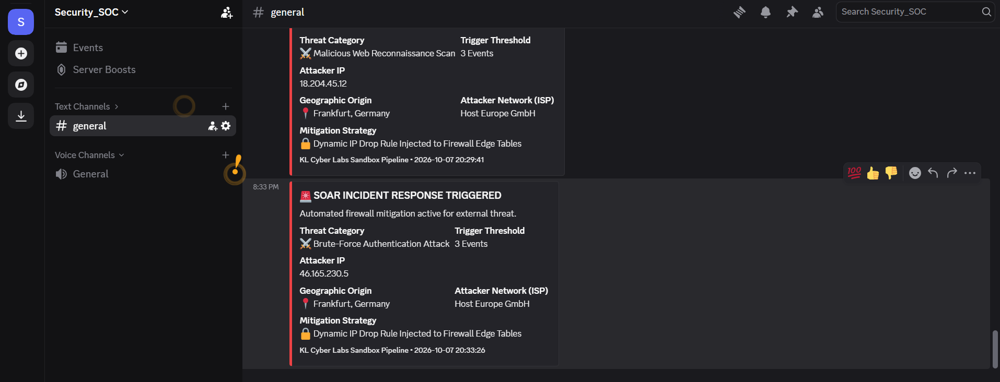

# 🛡️ Cloud-Native SOAR: Automated Threat Detection & Incident Response Pipeline

A production-grade **Security Orchestration, Automation, and Response (SOAR)** framework designed to ingest threat telemetry, execute automated mitigation playbooks, maintain hybrid audit logging (edge and cloud), and dispatch real-time incident notifications to Security Operations Center (SOC) teams.

---

## 🏗️ Technical Architecture & Workflow

The pipeline utilizes a hybrid storage architecture: local edge logging to **SQLite3** ensures low-latency fault tolerance during network partitioning, while cloud synchronization to **MongoDB Atlas** maintains a centralized threat intelligence database.

## Live Production Proof
Below is the live operational verification showing the SOAR pipeline intercepting an active multi-line Brute-Force Authentication Threat and broadcasting high-fidelity data to the target monitoring endpoint:

